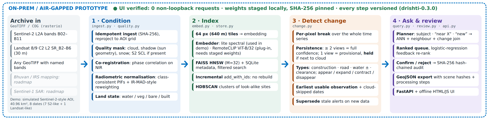

# DRISHTI architecture note

Pipeline version `drishti-0.3.0`. This note describes the code as implemented in this repository; items marked
*roadmap* are not built.

## 1. Deployment boundary

Everything runs in one Python process group on one machine: a FastAPI service (`drishti/api.py`) that serves the
offline HTML/JS UI (`web/index.html`) and a store directory on local disk. There are no outbound calls in the code;
optional model weights are read only from `models/` and only when a matching SHA-256 pin file sits next to them.
The UI screenshot run (`scripts/screenshots.py`) logs every non-loopback request the browser attempts; it logged 0.

## 2. Store layout (`drishti/store.py`)

| Part | Content |
|---|---|
| `drishti.sqlite` | tables `meta` (AOI grid, reference scene, embedder name/dim), `scenes`, `tiles`, `changes`, `decisions`, `audit` |
| `index.hnsw.faiss` | `faiss.IndexIDMap2(IndexHNSWFlat(dim, M=32, inner product))`; ids = `tiles.tile_id` |
| `vectors.f32` | raw L2-normalised vectors (append-only, memory-mapped) for exact re-scoring and image-to-image search |
| `cache/<scene>.npz` | per-scene normalised reflectance summary, usable mask and land state used by change analysis and chips |

*Filtered search.* Filters (date range, sensor, minimum usable fraction, change joins) are resolved in SQLite to a
candidate id set. If the set has ≤ 20,000 ids the vectors are scored exactly; otherwise HNSW is searched with a
`faiss.IDSelectorBatch` through `SearchParametersHNSW` (efSearch ≥ 128). Unfiltered search uses efSearch ≥ 64.

*Audit.* Every ingest, change run and analyst decision appends a row whose `hash = SHA-256(prev_hash + canonical
payload)`. `verify_audit()` recomputes the chain; the UI and every export report whether it is intact.

## 3. Ingest and conditioning (`drishti/ingest.py`, `drishti/raster.py`, `drishti/quality.py`)

Per scene, in acquisition order:

1. **Read** (`raster.read_scene`): bands found by description aliases (Sentinel-2 `B02..B11`, Landsat C2
   `SR_B2..SR_B6`, or `blue/green/red/nir/swir16`), reflectance = DN × `SCALE` + `OFFSET` (tags), optional `scl`
   band. The first clear scene defines the AOI grid; later scenes are reprojected onto it (bilinear; SCL nearest).
   A file whose SHA-256 is already in `scenes` is skipped (idempotent ingest).
2. **Quality mask**: with SCL, classes 8/9/10 = cloud, 3 = shadow, 11 = snow. Without SCL, spectral cloud tests,
   dilation, cloud shadow projected along the sun direction, and an NDSI-like snow test.
3. **Co-registration** to the reference: phase correlation on high-pass-filtered NIR, applied with an OpenCV affine
   warp. On the simulated AOI an injected shift of (1.6, −1.2) px was estimated as (1.80, −1.24) px.
4. **Radiometric normalisation** to the reference: pseudo-invariant features are pixels whose coarse land state is
   the same in both dates and is water, built or bare (this is what keeps seasonal vegetation out of the fit), then
   an iteratively reweighted (IR-MAD-style) per-band linear fit. On the simulated AOI an injected gain of 0.88 was
   recovered as ≈1.12–1.14 per band.
5. **Land state**: rule-based water / vegetation / bare / built from normalised indices (NDVI, MNDWI, NDBI, brightness).
6. **Tiles and embeddings**: 64 × 64 px tiles (640 m at 10 m); each tile stores bounds, lon/lat, usable fraction and
   land-state fractions, and one vector from the active embedder.
7. **Provenance**: every step (method, parameters, estimates) is written to `scenes.processing` as JSON.

## 4. Embedders (`drishti/embed.py`)

* **`drishti-lite-spectral-v1`** (used for all reported results; 52-d, no pretrained weights): a concept part
  (water, vegetation, forest, bare, built, road, texture, shore fractions, square-root encoded) plus a visual part
  (colour / texture statistics). Text queries map through a small lexicon to the same concept space. It cannot
  answer concepts outside that lexicon (e.g. vehicles).
* **`RemoteCLIPEmbedder`** (OpenCLIP `ViT-B-32` + RemoteCLIP checkpoint): tile RGB → image embedding; text →
  averaged prompt-template embedding. Loads only if `models/RemoteCLIP-ViT-B-32.pt` and its `.sha256` pin exist and
  match; uses `torch.load(weights_only=True)`. Implemented but **not executed** in our build environment.
* `get_embedder()` falls back to the lite embedder whenever RemoteCLIP is unavailable. The store records the embedder
  name and dimension; opening a store with a different embedder is refused.

## 5. Change engine (`drishti/change.py`)

1. Stack land states for all dates in the window; unusable pixels are 0 (unknown).
2. Two label hierarchies: **L1** {water, built, land} and **L2** {vegetation, bare} (L2 only for pixels that are
   land throughout, with a *pure pre* rule so seasonal crop cycles do not break).
3. **Break detection** per pixel: for each candidate date t, score = (share of the dominant class among usable
   observations before t) × (share of the dominant class after t), requiring ≥ 2 usable pre observations, ≥ 1 post,
   and different dominant classes. The best-scoring t is the break. Only dates inside the requested window can be
   breaks; unusable (cloud / shadow / snow) observations simply do not count.
4. **Objects**: pixels with score ≥ 0.6 per (pre, post) pair are grouped (dilation 3, 8-connectivity); groups under
   15 px are dropped.
5. **Earliest usable observation**: first date on which ≥ 50 % of the object's usable pixels show the new state;
   *last pre observation* is the last date showing the old state; intervening dates whose object pixels were
   unusable are listed as *cloud-skipped*.
6. **Persistence and cloud proximity**: support = number of usable post-change observations. Support ≥ 2 → full
   weight; support 1 → *provisional* (× 0.65); support 1 **and** within 12 px of cloud/shadow in that acquisition →
   **held** (not reported; re-evaluated when the next scene arrives).
7. **Confidence** = mean break score × persistence × (0.6 + 0.4 × mean usable fraction over all dates) ×
   (0.7 + 0.3 × size), with size = 1 − e^(−area_px / 40).
8. **Typing**: construction (→ built), road (→ built with elongation ≥ 4 and mean width ≤ 5 px), water increase /
   decrease, clearance (vegetation → bare), demolition, inundation, reclamation. **Sub-type** from a 6-px ring
   around the object: appearance / expansion (ring already had ≥ 40 built or ≥ 20 water px) / contraction /
   disappearance.
9. **Supersede**: pending events from earlier runs that the new run does not reproduce are marked `superseded`
   (kept for audit, hidden from the queue). Each run writes a `CHANGE_RUN` audit row with raw flip count, reported
   pixels, suppression ratio, held and superseded counts.

## 6. Query planner and search (`drishti/query.py`)

A text query is parsed into **subject** (embedding target), optional **relation** ("near / along / beside X": the
tile or its 8 neighbours must score ≥ 0.3 for X) and optional **temporal cue** ("new, newly built, recent…": join
with change events of the matching type overlapping the tile). Candidates come from filtered ANN (top 300), are
re-scored, demoted by (1 − usable fraction) so the clearest view of a place wins, tiles < 25 % usable are dropped, and
results are de-duplicated by location. Image-to-image search uses a tile's stored vector. Relevance feedback
(Rocchio) moves the query vector toward confirmed and away from rejected tiles.

## 7. Review, discovery, export (`drishti/review.py`)

* **Queue**: pending events ranked by confidence; once analysts have made decisions, a logistic-regression model on
  event features (confidence, log area, provisional flag, usable fraction, persistence count, elongation, type
  one-hot) re-ranks the queue.
* **Decisions**: confirm / reject with analyst id and note → `decisions` + audit row.
* **Discovery**: HDBSCAN over one scene's tile vectors groups look-alike sites; "find similar" runs image search.
* **Export**: GeoJSON of confirmed events; each feature carries before/after scene ids and SHA-256, the processing
  steps of both scenes, the decision history and the audit-chain verification result.

## 8. Complexity and scaling notes

* Ingest is O(pixels) per scene plus O(tiles · log N) HNSW inserts; nothing is rebuilt when scenes are added.
* Change analysis is O(T · H · W) for the break search (cumulative sums, vectorised over pixels) plus per-object
  work; for long archives run it over a window (`date_from` / `date_to` are supported by the API).
* Measured index scaling (`docs/EVALUATION_REPORT.md`, synthetic clustered vectors): 100k × 512-d, HNSW M=32, efConstruction 80,
  efSearch 128 → recall@10 0.916, p50 0.53 ms, 222 MB; 90k built in 29.3 s, the last 10k added in 5.0 s.
* *Roadmap*: IVF-PQ compression and region/year sharding for very large archives; Sentinel-1 SAR as an all-weather
  evidence stream; Bhuvan / IRS band mappings; Fmask for Landsat.
